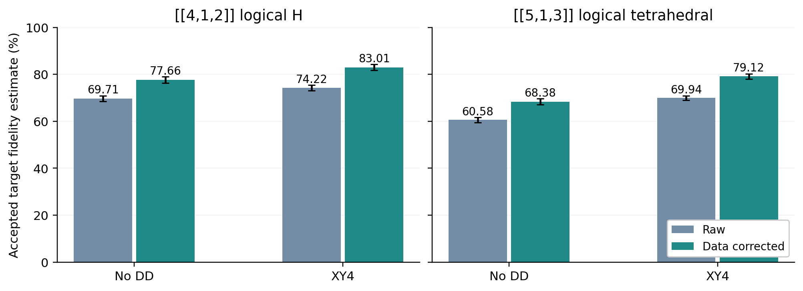

# IBM Aachen hardware experiments

Four- and five-qubit B2_ED: no DD versus XY4

Prepared 14 October 2026 (Pacific) from archived results. Percentages are rounded; changes are percentage points (pp).
 
## Four completed hardware experiments

The four-qubit encoded H state and the five-qubit encoded positive tetrahedral state were each prepared with B2_ED on ibm_aachen, with and without explicit XY4. Both comparisons show higher accepted-state fidelity estimates in the XY4 job. The primary estimator corrects final data readout while retaining the actual recorded-zero syndrome selection.

Overview. Raw and data-readout-corrected estimates from the four completed jobs. Error bars are 95% sampling intervals with calibration fixed. Each code has its own target, preparation circuit and calibration snapshot.

| Code / target | DD | Raw F | Corrected F | 95% CI (%) | Acceptance |
|---|---|---|---|---|---|
| Four / H | No DD | 69.71% | 77.66% | [76.26, 79.05] | 48.44% |
| Four / H | XY4 | 74.22% | 83.01% | [81.68, 84.34] | 50.98% |
| Five / tetrahedral | No DD | 60.58% | 68.38% | [67.14, 69.62] | 37.74% |
| Five / tetrahedral | XY4 | 69.94% | 79.12% | [77.97, 80.27] | 38.57% |

Five-qubit addition: corrected fidelity rises by +10.74 pp, with 95% sampling interval [9.05, 12.43] pp. The earlier four-qubit difference was +5.35 pp [3.43, 7.28]. Dedicated acceptance differences include zero in both comparisons.

> These are sequential job comparisons, with no interleaving or randomization. Shot-only intervals exclude calibration uncertainty and hardware drift. The four- and five-qubit results are not a controlled code-ranking experiment: targets, circuit sizes, checks and calibration snapshots differ. No active recovery was implemented.

This update analyzes existing results only: 360,448 attempted hardware shots across four jobs. No new IBM job or noise simulation was run for this report update. The five-qubit results follow; the earlier four-qubit analysis is retained in full.

## Five-qubit B2_ED: protocol and measured performance

Target: the [[5,1,3]] encoded positive tetrahedral state, with logical Bloch vector (1,1,1)/sqrt(3). The four checks are XZZXI, IXZZX, XIXZZ and ZXIXZ in syndrome-bit order s0 through s3. Accept displayed s3s2s1s0 = 0000. This is encoding followed by detection and rejection; it does not exercise the code's single-error correction capability through active recovery.

| Quantity | No DD | XY4 |
|---|---|---|
| Raw accepted target fidelity | 60.576% | 69.938% |
| Data-corrected accepted fidelity | 68.378% | 79.119% |
| Corrected 95% sampling CI (%) | [67.138, 69.619] | [77.966, 80.271] |
| Dedicated acceptance | 773/2048 = 37.744% | 790/2048 = 38.574% |
| Acceptance Wilson 95% CI (%) | [35.670, 39.865] | [36.489, 40.702] |
| Pooled acceptance; supplementary | 37.401% | 38.879% |

Each job used 63 nonidentity target-projector Pauli settings and one dedicated acceptance circuit, all at 2,048 shots: 131,072 attempted shots/job. Fidelity is F_hat = 1/32 + sum c_P mean(parity_P | recorded 0000), using the full five-qubit target projector. No additional codespace filtering is applied.

| Run | IBM job ID | Execution, 14 Oct 2026 Pacific |
|---|---|---|
| XY4 (first) | db8622rkbioc73chut2g | 22:13:52-22:14:29 |
| No DD (second) | db865b5bgg3c73emfbkg | 22:20:49-22:21:30 |

The submissions were 6.95 minutes apart. The original preparation and routing are shared: 106 CZ gates, 181 sx gates, 95 virtual rz gates and 2 X gates before DD. Final data bits map to [6,5,4,16,2]; syndrome bits map to [0,23,1,3].

XY4 protects 28 eligible idle windows with 112 additional native X pulses and 112 virtual Rz gates. This includes all five output qubits during the 2.180 microsecond syndrome-readout wait. Original gate timestamps and the 9.992 microsecond preparation-through-delivery duration are preserved. Automatic Runtime DD and gate/measurement twirling are disabled; rep_delay is 250 microseconds.

> The corrected fidelity difference is +10.741 pp; normal CI [9.047, 12.434] and independent-bootstrap CI [9.022, 12.443] pp. Dedicated acceptance changes by +0.830 pp, CI [-2.146, 3.806] pp; this acceptance result is inconclusive.

## Five-qubit analysis: readout correction and diagnostics

The primary correction inverts only final data assignment errors using per-qubit directional matrices from the saved calibration. It preserves every recorded-0000 acceptance decision. The two jobs have byte-identical calibration files (snapshot 21:32:08 Pacific); the directional readout entries themselves date to 19:34:04-05, about 2 hours 40-47 minutes before execution. This calibration age is not included in the sampling intervals.

| Data bit | Physical qubit | P(record 1 \| true 0) | P(record 0 \| true 1) |
|---|---|---|---|
| 0 | 6 | 0.098% | 1.367% |
| 1 | 5 | 0.244% | 0.439% |
| 2 | 4 | 0.684% | 1.270% |
| 3 | 16 | 3.125% | 2.490% |
| 4 | 2 | 2.344% | 4.443% |

| Diagnostic score | No DD | XY4 |
|---|---|---|
| All-outcome raw target score | 35.582% | 42.455% |
| Rejected raw target score | 20.704% | 25.023% |
| Raw code-projector score | 60.785% | 70.205% |
| Data-corrected code-projector score | 68.610% | 79.366% |
| Joint-corrected fidelity; latent 0000 | 68.882% | 79.682% |

Joint data-plus-syndrome inversion estimates the latent true-0000 ensemble, which differs from the delivered recorded-0000 ensemble. It is diagnostic only. Code-projector scores estimate the population inside the code subspace under the same readout assumptions; no hardware density matrix or additional physical projection was reconstructed.

All 128 Runtime circuit results reproduce the archived shot histograms. Raw fidelity and standard error match both retrieval and independent bit-count calculations. Corrected observable scores agree with distribution inversion within 1.3e-15. Tensor condition numbers are 1.196 (data) and 1.305 (joint). Negative quasiprobabilities and estimates are retained without clipping.

Uncertainty uses 10,000 per-setting multinomial bootstrap replicates. Estimators share resamples within a job, and jobs have independent random streams. Normal and bootstrap intervals agree. Acceptance homogeneity across 64 settings gives chi-square(63) = 77.39, p = 0.105 (no DD) and 59.47, p = 0.603 (XY4); this does not rule out hardware drift.

> The fidelity increase is much larger than estimated sampling noise, but cannot be uniquely assigned to DD from one sequential pair. No matched hardware B1 control, fault-tolerant verification, active correction, fresh readout-calibration experiment or five-qubit live-calibration noise replay was run.

Five-qubit sources: [comparison and uncertainty](../results/hardware_b2ed/five_comparison_20261014/analysis.json), [readable analysis](../results/hardware_b2ed/five_comparison_20261014/report.md), [no-DD extended analysis](../results/hardware_b2ed/five_pilot_20261014/analysis_extended.json), [XY4 extended analysis](../results/hardware_b2ed/five_xy4_20261014/analysis_extended.json), [offline analyzer](../scripts/analyze_ibm_five_b2ed.py). The executed [hardware notebook](../notebooks/03_ibm_aachen_hardware_results.ipynb) displays both code comparisons.

## Four-qubit study: Final measured performance

We ran the four-qubit B2_ED encoded-H preparation on IBM Aachen twice: a baseline with no DD, followed by the same circuit with explicit XY4 pulses inserted into long idles. The primary final result is the fidelity estimate after correcting final data readout, while keeping the actual recorded-000 acceptance rule.

![Figure 1. Measured accepted-state fidelity estimates. Error bars are 95% normal sampling intervals with calibration treated as fixed. Readout correction changes the estimate, not the prepared state. [H1]](figures/hardware_fidelity.png)

Figure 1. Measured accepted-state fidelity estimates. Error bars are 95% normal sampling intervals with calibration treated as fixed. Readout correction changes the estimate, not the prepared state. [H1]

| Primary metric | No DD | XY4 |
|---|---|---|
| Data-readout-corrected fidelity | 77.659% | 83.011% |
| 95% sampling interval (%) | [76.264, 79.054] | [81.684, 84.338] |
| Raw accepted fidelity score | 69.709% | 74.219% |
| Dedicated acceptance | 992/2048 = 48.438% | 1044/2048 = 50.977% |
| Acceptance Wilson 95% interval (%) | [46.278, 50.603] | [48.812, 53.138] |
| Data-corrected codespace score | 79.018% | 84.857% |

The observed XY4 minus baseline difference is +5.352 percentage points after data correction, with 95% sampling interval [3.427, 7.278] points. The raw-score difference is +4.511 points. Dedicated acceptance changes by +2.539 points; its difference interval includes zero.

> The two jobs were about 24.5 minutes apart, with no interleaving or randomization. Sampling intervals exclude drift and calibration error. The observed improvement supports XY4 as a promising intervention, but does not isolate its causal effect from time-dependent hardware changes.

## Four-qubit study: Experiment and execution details

Target: |HL⟩ = cos(π/8)|0L⟩ + sin(π/8)|1L⟩, with |0L⟩ = (|0000⟩+|1111⟩)/√2 and |1L⟩ = (|0011⟩+|1100⟩)/√2. The [[4,1,2]] stabilizers are XXXX, IIZZ and ZZII, recorded as syndrome bits 0, 1 and 2. The displayed bitstring is s2s1s0. Accept only 000; no active Pauli recovery is applied.

| Run | IBM job ID | Execution on 14 Oct 2026 (Pacific) |
|---|---|---|
| No DD | db84dj8331ic73fu5jfg | 20:21:53-20:22:11 |
| XY4 | db84p30331ic73fu5tm0 | 20:46:23-20:46:42 |

Each job contained 24 circuits × 2,048 attempted shots = 49,152 shots: one dedicated acceptance-only circuit and 23 target-projector Pauli settings. Total: 98,304 attempted shots. A frozen preparation prefix is shared across settings; only the final analysis basis changes. Joint data and syndrome counts are archived, preserving their correlations. [H2, H3]

| Circuit property | Value |
|---|---|
| Backend / calibration | ibm_aachen / live snapshot 14 Oct 2026, 20:06:27 Pacific |
| Fixed local patch | [3, 2, 4, 16, 1, 5, 23, 0, 6] |
| Output data q0, q1, q2, q3 | Physical qubits [5, 3, 2, 16] |
| Output syndrome s0, s1, s2 | Physical qubits [1, 4, 23] |
| No-DD preparation resources | 39 CZ, 67 sx, 40 virtual rz; 31 delays |
| Preparation through syndrome delivery | 2.840 µs before readout + 2.180 µs readout = 5.020 µs |
| Runtime execution options | Initialize qubits; 250 µs inter-shot rep_delay; classified readout |
| Other automated suppression | Gate/measurement twirling OFF; automatic Runtime DD OFF |

The 5.020 µs delivery time excludes the subsequent destructive basis-analysis and data-measurement suffix. The 250 µs repetition delay is between shots, not a data-storage wait within the preparation. Each variant used one SamplerV2 job, with no Session or Batch.

> Both archived manifests use the same calibration file. This helps match the comparison but does not show that the hardware noise was constant between jobs. Both circuit sets passed ideal statevector and ISA validation; all 24 ideal settings agreed to approximately 10^-15.

## Four-qubit study: Error suppression: postselection and XY4

| Strategy actually used | Purpose | What it changes |
|---|---|---|
| Syndrome postselection | Discard detected faults | Retains recorded-000 runs; reduces yield |
| Explicit XY4 during eligible idles | Refocus slow phase / coherent idle noise | Changes physical evolution before state delivery |
| Offline data-readout correction | Remove assignment bias in fidelity estimates | Changes statistical weights; acceptance unchanged |

XY4 uses Xπ, Yπ, Xπ, Yπ in each eligible noninitial idle of at least 500 ns. Nine windows were protected, adding 36 native 32 ns X pulses and 36 virtual Rz operations, with no additional CZ gates. A Y pulse is synthesized by virtual Rz(-π/2), native X, then virtual Rz(+π/2). Initial and post-measurement idles are skipped.

![Figure 2. Actual saved XY4 pulse positions in the terminal readout window. Other protected windows occur earlier during extraction. This is an instruction-timing view, not an analog waveform. [H3]](figures/hardware_xy4_readout_timing.png)

Figure 2. Actual saved XY4 pulse positions in the terminal readout window. Other protected windows occur earlier during extraction. This is an instruction-timing view, not an analog waveform. [H3]

All four output data qubits receive XY4 during the 2.180 µs ancilla-readout wait. Pulse starts are 3.096, 3.640, 4.188 and 4.732 µs from circuit start; each pulse is 0.032 µs. Free-gap fractions are approximately 1/8, 1/4, 1/4, 1/4, 1/8, rounded to the device clock.

The original gate and measurement timestamps, mapping, and total 5.020 µs preparation duration are preserved. The physical aim is to refocus slowly varying phase errors while the state would otherwise idle. DD does not reverse irreversible T1 decay, fix already faulty entangling gates, or correct classical readout assignments.

> No adaptive syndrome recovery, repeated checks, flag-ancilla protocol, zero-noise extrapolation, or gate twirling was used. The flag-circuit paper discussed separately remains a possible future experiment, not an explanation of these results.

Background: [IBM error-suppression guidance](https://quantum.cloud.ibm.com/learning/en/courses/tools-for-quantum-advantage/error-suppression).

## Four-qubit study: How fidelity is estimated

We estimate overlap with the full four-qubit target, including loss outside the code subspace. This is not full density-matrix tomography and not an estimate from logical X, Y and Z alone.

Let P_code be the stabilizer projector, XL = IIXX and ZL = IZIZ. The target projector is O = P_code [I + (XL + ZL)/√2] / 2 = Σ c_P P. Its identity coefficient is 1/16, and 23 nonidentity Pauli coefficients are nonzero.

For each Pauli P, prepare a fresh state, read the syndrome, wait for its readout to finish, and measure the data in the required basis: H before Z-readout for X, S† then H for Y, and direct Z-readout for Z. Identity factors do not enter the parity. Compute the mean parity only among the recorded-000 shots in that setting. Then F_hat = 1/16 + Σ_(P ≠ I) c_P mean(parity_P | recorded 000).

## Four-qubit study: Offline assignment correction

For each data qubit, the saved directional calibration supplies A[true,recorded] = [[1-e01,e01],[e10,1-e10]]. Solve A w = (1,-1), and replace raw parity by the product of the appropriate single-bit weights. Identity factors have weight one. This independent-qubit tensor model is implemented directly; no M3 package or new calibration experiment was used. [H1]

| Output data bit | Physical qubit | P(record 1 \| true 0) | P(record 0 \| true 1) |
|---|---|---|---|
| 0 | 5 | 0.244% | 0.439% |
| 1 | 3 | 0.732% | 1.416% |
| 2 | 2 | 2.344% | 4.443% |
| 3 | 16 | 3.125% | 2.490% |

The primary correction uses only final data assignment matrices. It neither changes which shots passed nor retroactively fixes syndrome decisions. It also does not correct noisy basis gates, crosstalk, correlated readout, or the quantum-state preparation itself. Directional calibration entries were measured around 19:34 Pacific, roughly 48 and 72 minutes before the two jobs.

## Four-qubit study: Uncertainty and the syndrome-corrected diagnostic

Variance is propagated from per-setting parity or corrected-weight samples. Normal 95% intervals are cross-checked with 10,000 multinomial bootstrap resamples of the joint histograms. Within-job raw/corrected comparisons are paired; the two jobs are treated as independent. These quantify shot noise only, conditional on fixed calibration and independent shots.

A secondary analysis also inverts syndrome assignment and uses all recorded syndromes to estimate the latent true-000 conditional ensemble. Its corrected numerator/denominator covariance is included. That answers a different question from the quality of the actually retained shots; it cannot identify and repair individual wrongly accepted or rejected shots.

| Fidelity estimate | No DD | XY4 |
|---|---|---|
| Raw; recorded 000 | 69.709% | 74.219% |
| Data corrected; recorded 000 | 77.659% | 83.011% |
| Joint corrected; latent true 000 | 77.944% | 83.315% |

## Four-qubit study: What the results establish, and their limits

Postselection separates a substantially higher-quality ensemble from the rejected outcomes. The same target-projector estimator gives the following raw scores. They still include final measurement bias. [H2, H3]

| Raw target score | No DD | XY4 |
|---|---|---|
| All outcomes | 52.520% | 55.563% |
| Recorded 000 accepted | 69.709% | 74.219% |
| Rejected outcomes | 36.207% | 36.870% |

This demonstrates useful statistical filtering within each executed syndrome circuit. It does not demonstrate an end-to-end advantage over a separately run B1 circuit: there was no hardware B1 control at a matched consumption time. Nor do the data identify exactly how many physical fault events were corrected; no active recovery was performed.

## Four-qubit study: Model replay versus hardware

| Quantity | No DD | XY4 |
|---|---|---|
| Saved-calibration model acceptance | 91.441% | 91.165% |
| Hardware dedicated acceptance | 48.438% | 50.977% |
| Model raw measurement score | 84.277% | 83.980% |
| Hardware raw measurement score | 69.709% | 74.219% |
| Model exact preparation fidelity | 94.603% | 94.272% |

The replay uses each frozen hardware circuit and its saved live calibration, rather than the April packaged snapshot. It predicts a small XY4 penalty, whereas hardware shows a higher score in the XY4 job. The gap is consistent with missing noise or control effects in the simple model, but these data cannot uniquely attribute it to slow phase noise, idles, crosstalk, drift, or another mechanism. [H4]

No hardware density matrix was reconstructed. The data-corrected code-projector scores, 79.018% and 84.857%, are estimates with the same calibration and measurement assumptions. Their ratio with a fidelity estimate is not presented as an exact within-code state fidelity.

> Final performance statement: XY4 achieved a data-readout-corrected accepted target fidelity estimate of 83.011%, with 95% shot-only interval [81.684%, 84.338%], at measured dedicated acceptance 50.977%. The baseline estimate was 77.659%. No claim of fault tolerance, isolated DD causality, or a complete hardware error budget follows from these two jobs.

## Four-qubit study: Provenance and reproduction

Verified from archived joint counts, raw Runtime results, manifests, calibration files, and analysis outputs. No new IBM jobs were submitted for this report. [H1] [Readout analysis](../results/hardware_b2ed/readout_mitigation_20261014/readout_mitigation.json). [H2] [Baseline analysis](../results/hardware_b2ed/four_pilot_20261014/analysis_extended.json). [H3] [XY4 manifest](../results/hardware_b2ed/four_xy4_20261014/manifest.json) and [analysis](../results/hardware_b2ed/four_xy4_20261014/analysis_extended.json). [H4] [Baseline replay](../results/hardware_b2ed/four_pilot_20261014/calibration_replay.json) and [XY4 replay](../results/hardware_b2ed/four_xy4_20261014/calibration_replay.json).

Methods: [IBM readout mitigation](https://quantum.cloud.ibm.com/docs/en/tutorials/readout-error-mitigation-sampler). Code: [hardware estimator](../src/logical_magic/ibm_b2ed.py), [XY4 insertion](../src/logical_magic/ibm_dd.py), [offline correction](../scripts/mitigate_ibm_b2ed_readout.py). [Executed hardware notebook](../notebooks/03_ibm_aachen_hardware_results.ipynb). Input hashes: [source manifest](summary_report_sources.json).
