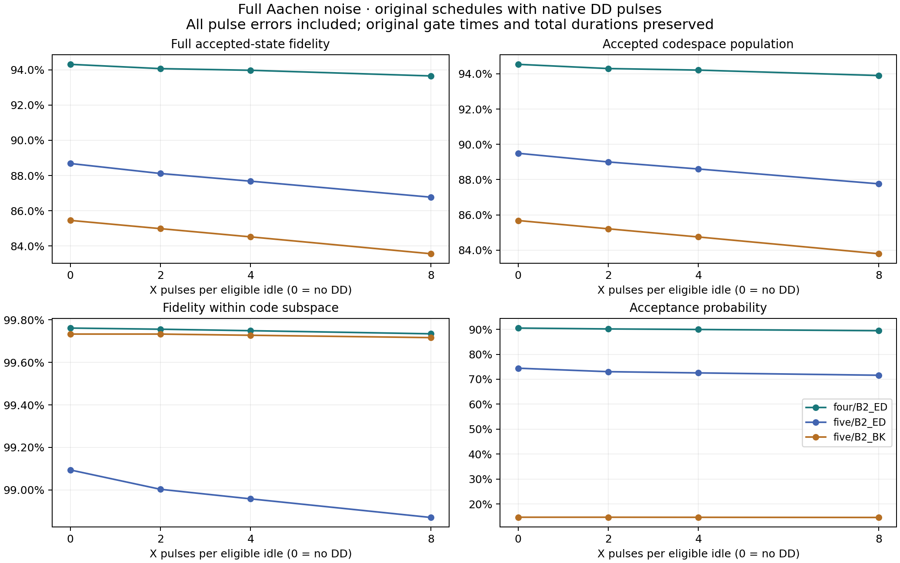
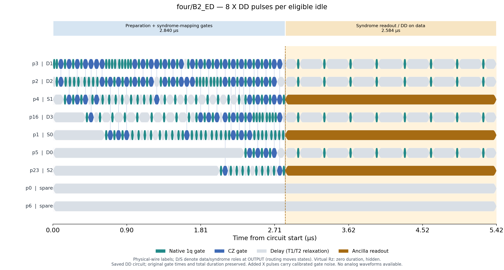
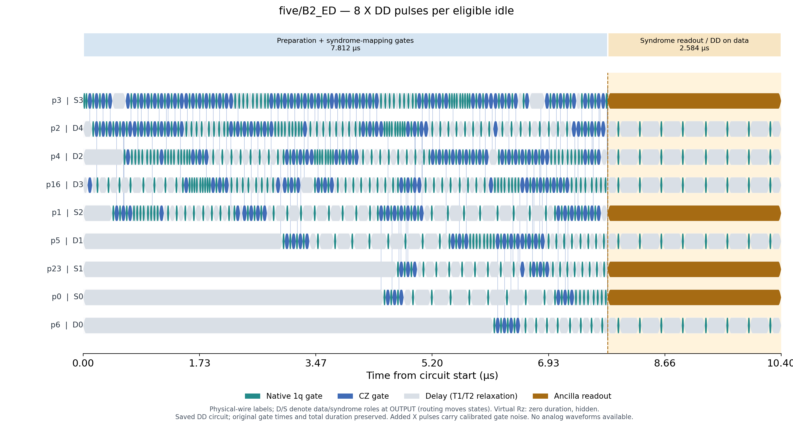
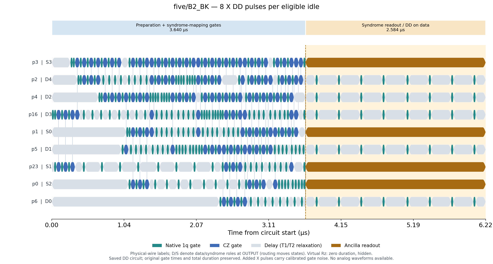

# Dynamical decoupling with the full Aachen noise model

## Baseline and implementation

This comparison returns to the **original optimized saved QPY circuits**, rather than the stage-separated circuits used for the phase-ablation studies. The no-DD full-noise accepted density matrix is replayed and checked against the original saved result. Every experiment calls `simulate_scheduled(..., mode='full')`: gate depolarization, gate-duration T1/T2 relaxation, all remaining Delay relaxation, and syndrome assignment error are enabled. No earlier channel-removal setting is used.

Qiskit's `PadDynamicalDecoupling` inserts balanced sequences of 2, 4, or 8 native X gates into sufficiently long idles. Initial ground-state idles are skipped. The backend gives each X gate a 32 ns duration and its calibrated noise channel. Added pulses keep their native names with no custom labels, so ordinary Aachen X-gate noise applies. Remaining gaps remain noisy. There is no synthesis, routing change, or optimization after DD insertion.

The original gates and measurements retain exactly their prior start times. The pulse sequences fit inside the original delays, and total duration is unchanged. All final data wires receive the chosen sequence during the 2.584 µs syndrome-readout wait. Higher pulse counts may cause shorter idle windows to be skipped, so these settings specify pulses per eligible window, not a uniform pulse repetition rate across the circuit. Actual pulse counts and timestamps are saved.

## Full accepted-state fidelity

| Protocol | No DD | 2 X / eligible idle | 4 X / eligible idle | 8 X / eligible idle |
|---|---:|---:|---:|---:|
| four/B2_ED | 94.3088% | 94.0653% | 93.9717% | 93.6507% |
| five/B2_ED | 88.6818% | 88.1138% | 87.6781% | 86.7702% |
| five/B2_BK | 85.4524% | 84.9841% | 84.5173% | 83.5599% |

## State quality and pulse cost

| Protocol | DD pulses per eligible idle | Added X gates | Protected idle windows | Codespace population | Within-code fidelity | Full fidelity | Acceptance |
|---|---:|---:|---:|---:|---:|---:|---:|
| four/B2_ED | 0 | 0 | 0 | 94.5341% | 99.7616% | 94.3088% | 90.5051% |
| four/B2_ED | 2 | 36 | 18 | 94.2951% | 99.7562% | 94.0653% | 90.1574% |
| four/B2_ED | 4 | 60 | 15 | 94.2079% | 99.7493% | 93.9717% | 89.9402% |
| four/B2_ED | 8 | 120 | 15 | 93.8999% | 99.7346% | 93.6507% | 89.4490% |
| five/B2_ED | 0 | 0 | 0 | 89.4925% | 99.0941% | 88.6818% | 74.4221% |
| five/B2_ED | 2 | 96 | 48 | 89.0011% | 99.0030% | 88.1138% | 73.0323% |
| five/B2_ED | 4 | 172 | 43 | 88.6013% | 98.9580% | 87.6781% | 72.5390% |
| five/B2_ED | 8 | 312 | 39 | 87.7615% | 98.8705% | 86.7702% | 71.6044% |
| five/B2_BK | 0 | 0 | 0 | 85.6809% | 99.7334% | 85.4524% | 14.7074% |
| five/B2_BK | 2 | 64 | 32 | 85.2112% | 99.7334% | 84.9841% | 14.7087% |
| five/B2_BK | 4 | 100 | 25 | 84.7480% | 99.7278% | 84.5173% | 14.6767% |
| five/B2_BK | 8 | 176 | 22 | 83.7973% | 99.7167% | 83.5599% | 14.6071% |

All state quantities are exact density-matrix diagnostics conditioned on recorded-zero syndrome. The within-code fidelity additionally normalizes the projected state for diagnosis; it is not another physical selection. 8,192 syndrome shots per variant are saved as an independent acceptance check, not a finite-shot fidelity estimator.

## What this noise model can say about DD

The calibrated idle channel is a memoryless, exponential T1/T2 relaxation channel. It has no explicit slow detuning, noise spectrum, temporal correlations, or coherent idle ZZ coupling. Echo pulses refocus coherent or sufficiently slow phase accumulation; this mechanism is absent from the current model. More pulses add calibrated gate noise and can reshape amplitude-damping bias, but they do not reverse this model's Markovian transverse decay. Consequently this test is not a prediction of DD effectiveness on Aachen hardware. The calibration snapshot alone does not determine the temporal correlations needed for that prediction.

The stored one-qubit sanity check uses ideal instantaneous pulses on physical qubit 3: over 2.584 µs, X coherence is 0.98983830 for no DD and for all three DD counts, matching exp(-t/T2). A separate constant-Z-detuning toy check refocuses exactly. That toy is a validation of the echo mechanism only; no detuning is added to the Aachen experiment and no hardware detuning strength is assumed.

Before using this simulation to optimize DD, a separate calibrated or explicitly parameterized model of correlated idle noise is needed. It must distinguish refocusable dephasing from irreversible relaxation rather than treating the previous no-delay ablation as achievable DD performance.

## Timing plots and reproducibility

### four/B2_ED with 8 X pulses per eligible idle

### five/B2_ED with 8 X pulses per eligible idle

### five/B2_BK with 8 X pulses per eligible idle

Results include `results.json`, `accepted_states.npz`, comparison PNG/PDF/SVG, DD timelines, and native QPY circuits in `circuits/`. The original QPY hashes are unchanged. Ideal accepted-state fidelity and acceptance are checked for all inserted sequences. Reproduce: `conda run -n quantum-jax python scripts/analyze_dd.py`.

Sources: [Qiskit DD padding](https://quantum.cloud.ibm.com/docs/en/api/qiskit/qiskit.transpiler.passes.PadDynamicalDecoupling), [IBM explanation of echo and slow noise](https://quantum.cloud.ibm.com/learning/en/courses/tools-for-quantum-advantage/error-suppression), [Markovian limits of DD](https://arxiv.org/abs/1710.11133).
