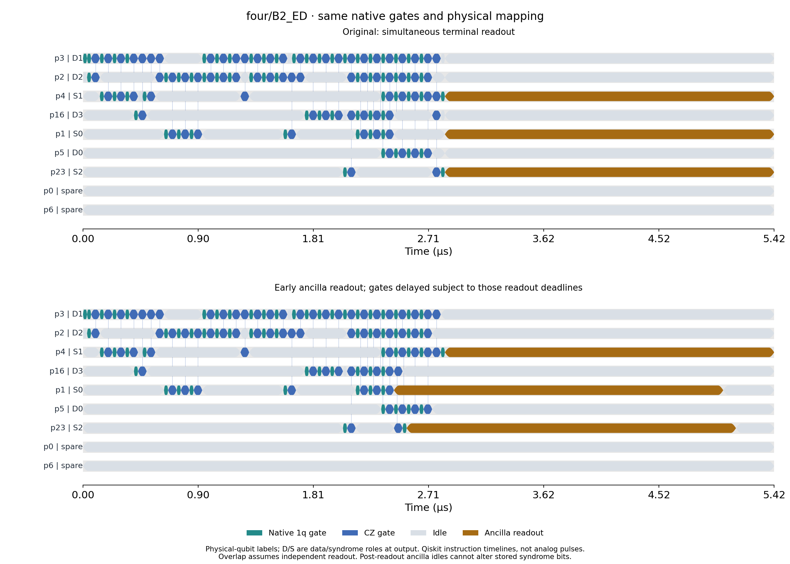
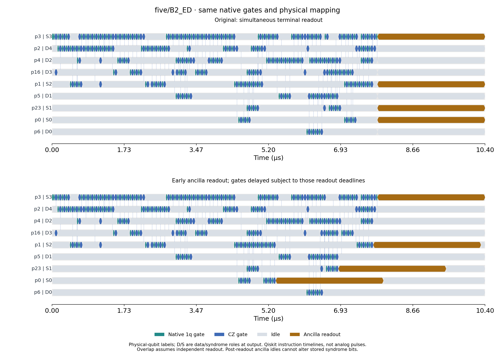
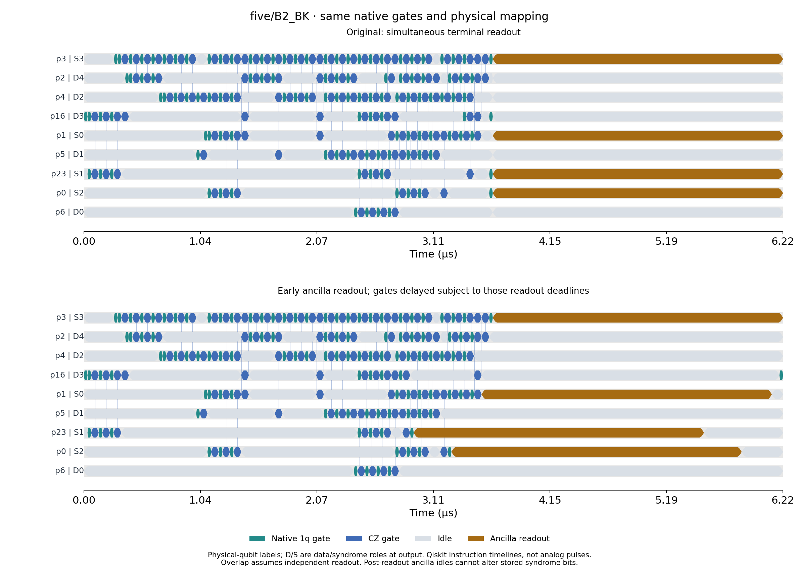

# Earlier syndrome readout on frozen Aachen circuits

## What changed

Four schedules use each original optimized native QPY circuit. There is no resynthesis, new routing, check reordering, qubit reassignment, DD, or gate removal. Per-wire native operation order, physical mappings, gate parameters and global phase are preserved. The original replay is checked against the saved full-noise density matrix.

1. **Original:** the existing terminal barrier aligns all syndrome measurements.
2. **Early readout; fixed gates:** remove that synchronization and measure each physical ancilla after its last gate, without moving any native gate.
3. **Early readout; ASAP gates:** schedule native gates as early as per-wire dependencies permit, then measure each ancilla.
4. **Early readout; ALAP gates:** retain the ASAP measurement times as deadlines, then move gates as late as possible without missing those deadlines or delivery. This differs from ordinary ALAP with all measurements aligned.

## Full-noise result

| Protocol | Schedule | Delivery (µs) | Acceptance | Codespace population | Within-code fidelity | Full fidelity |
|---|---|---:|---:|---:|---:|---:|
| four/B2_ED | Original | 5.424 | 90.5051% | 94.5341% | 99.7616% | 94.3088% |
| four/B2_ED | Early readout; fixed gates | 5.424 | 90.5022% | 94.5360% | 99.7617% | 94.3107% |
| four/B2_ED | Early readout; ASAP gates | 5.424 | 89.8241% | 94.0973% | 99.7595% | 93.8709% |
| four/B2_ED | Early readout; ALAP gates | 5.424 | 90.6116% | 94.4992% | 99.7617% | 94.2740% |
| five/B2_ED | Original | 10.396 | 74.4221% | 89.4925% | 99.0941% | 88.6818% |
| five/B2_ED | Early readout; fixed gates | 10.396 | 74.4111% | 89.5032% | 99.0942% | 88.6925% |
| five/B2_ED | Early readout; ASAP gates | 10.396 | 71.0635% | 89.0191% | 99.0865% | 88.2059% |
| five/B2_ED | Early readout; ALAP gates | 10.396 | 74.3528% | 89.5031% | 99.0944% | 88.6925% |
| five/B2_BK | Original | 6.224 | 14.7074% | 85.6809% | 99.7334% | 85.4524% |
| five/B2_BK | Early readout; fixed gates | 6.224 | 14.7054% | 85.6925% | 99.7335% | 85.4641% |
| five/B2_BK | Early readout; ASAP gates | 6.224 | 14.5190% | 85.2421% | 99.7152% | 84.9994% |
| five/B2_BK | Early readout; ALAP gates | 6.224 | 14.7160% | 85.8826% | 99.7350% | 85.6549% |

All fidelities and codespace populations describe the data state **at delivery, after every syndrome readout finishes**, conditioned on recorded all-zero syndrome. Within-code fidelity is an extra diagnostic, not another physical filter. Gate depolarization, gate-duration relaxation, pre-measurement ancilla idles, all data idles, and assignment errors remain enabled. State metrics are exact density-matrix calculations; the saved 8,192 syndrome shots per variant check acceptance, not a new finite-shot fidelity estimate.

## Timing and interpretation

| Protocol | Schedule | Ancilla readout starts (µs, syndrome-bit order) | Delivery (µs) |
|---|---|---|---:|
| four/B2_ED | Original | 2.840, 2.840, 2.840 | 5.424 |
| four/B2_ED | Early readout; fixed gates | 2.440, 2.840, 2.840 | 5.424 |
| four/B2_ED | Early readout; ASAP gates | 2.440, 2.840, 2.540 | 5.424 |
| four/B2_ED | Early readout; ALAP gates | 2.440, 2.840, 2.540 | 5.424 |
| five/B2_ED | Original | 7.812, 7.812, 7.812, 7.812 | 10.396 |
| five/B2_ED | Early readout; fixed gates | 7.312, 6.944, 7.712, 7.812 | 10.396 |
| five/B2_ED | Early readout; ASAP gates | 5.372, 6.876, 7.712, 7.812 | 10.396 |
| five/B2_ED | Early readout; ALAP gates | 5.372, 6.876, 7.712, 7.812 | 10.396 |
| five/B2_BK | Original | 3.640, 3.640, 3.640, 3.640 | 6.224 |
| five/B2_BK | Early readout; fixed gates | 3.540, 3.640, 3.640, 3.640 | 6.224 |
| five/B2_BK | Early readout; ASAP gates | 3.540, 2.936, 3.272, 3.640 | 6.224 |
| five/B2_BK | Early readout; ALAP gates | 3.540, 2.936, 3.272, 3.640 | 6.224 |

Earlier readout protects a finished ancilla's recorded syndrome from further ancilla storage errors. It does not recheck data errors that happen afterward. For these frozen gate dependencies, the final ancilla is still on the critical path: all four schedules have the same overall delivery time. Thus early readout alone does not remove the final data-storage burden. With fixed gate times, an unchanged unconditional data fidelity verifies that any accepted-state change comes from altered syndrome selection, not less data decoherence. ASAP also moves preparation earlier and can increase exposure of fragile states. The deadline-based ALAP schedule can move independent data-only gates into readout intervals; those gates and all intervening idles retain their calibrated noise.

## Exact measurement handling and validation

Each ancilla is measured once and is never reused. Its measurement commutes with every later operation on other wires. For exact syndrome-block evaluation, measurements are deferred only after dropping idles on already measured ancillas: their subsequent quantum relaxation cannot rewrite a classical bit. All data evolution is retained. Any later gate on a measured ancilla is rejected by the implementation. A Bell-pair test checks this distinction analytically while retaining data T1 decay. Every schedule retains ideal fidelity one and ideal acceptance one (ED) or one sixth (BK). Source QPY and calibration hashes are verified; per-wire operation order and absence of overlapping operations on a wire are asserted.

## Three representative check orders: separate matched compilation study

This additional study recompiles one frozen source preparation with the reference, reversed, and one-step-rotated whole-check order. The preparation/encoding gates and assignment of a stabilizer to its source ancilla are identical within each protocol. No arbitrary interleaving of controlled-Pauli factors is attempted: commuting stabilizers do not justify arbitrarily commuting all their elementary gates. Native routing, gate count, and final physical placement can change when the order changes. Optimization level 1, initial layout, calibration, and transpiler seed stay fixed.

The newly compiled reference order is the matched baseline for this table; it can differ from the original saved QPY because the original source encoder was not frozen at that time. Source QPY and stage metadata are now cached for exact reproduction. Check indices refer to the saved `checks_in_bit_order` list; only execution order changes, not the recorded-zero acceptance rule. Each order has both simultaneous terminal readout and early deadline-based ALAP readout, with full noise retained. Results are a small candidate comparison, not a global optimization.

| Protocol | Check execution order | Delivery (µs) | Terminal-readout fidelity | Early-readout fidelity | Early-readout codespace | Early-readout acceptance |
|---|---|---:|---:|---:|---:|---:|
| four/B2_ED | [0, 1, 2] | 5.424 | 94.3088% | 94.2740% | 94.4992% | 90.6116% |
| four/B2_ED | [2, 1, 0] | 5.252 | 93.8523% | 93.7873% | 94.0005% | 92.3082% |
| four/B2_ED | [1, 2, 0] | 5.252 | 93.8523% | 93.7873% | 94.0005% | 92.3082% |
| five/B2_ED | [0, 1, 2, 3] | 10.396 | 88.6818% | 88.6925% | 89.5031% | 74.3528% |
| five/B2_ED | [3, 2, 1, 0] | 9.528 | 89.5069% | 89.3949% | 89.7286% | 72.4200% |
| five/B2_ED | [1, 2, 3, 0] | 8.992 | 89.2383% | 89.2554% | 89.5749% | 74.6350% |
| five/B2_BK | [0, 1, 2, 3] | 6.224 | 85.4524% | 85.6549% | 85.8826% | 14.7160% |
| five/B2_BK | [3, 2, 1, 0] | 8.156 | 79.1976% | 79.2049% | 79.4480% | 13.3163% |
| five/B2_BK | [1, 2, 3, 0] | 6.524 | 84.7736% | 85.0115% | 85.2847% | 14.7181% |

For five-qubit ED, the reversed order with ordinary terminal readout changes fidelity from 88.6818% to 89.5069% and delivery from 10.396 to 9.528 µs. Acceptance changes from 74.4221% to 71.8367%. The rotated order gives 89.2383% fidelity at 74.6385% acceptance and 8.992 µs delivery. For BK, original-order early deadline-based ALAP gives 85.6549% fidelity versus 85.4524%, at unchanged delivery. These are candidate results, not proof of an optimum or isolated idle-error contributions: recompilation changes gate channels and physical mappings as well as timing. Acceptance must be considered alongside fidelity.

## Hardware scope and ordinary versus mid-circuit measurement

Ordinary `measure` and IBM `MidCircuitMeasure` implement the same logical computational-basis measurement. A mid-circuit measurement means a measurement while quantum computation continues; ordinary `measure` can be used there too. IBM's `MidCircuitMeasure` maps to `measure_2`, an implementation tuned for lower overhead during ongoing computation, whereas terminal-readout tuning need not prioritize keeping other quantum data alive. Actual durations and errors depend on the backend calibration. The packaged Aachen snapshot exposes only `measure`, with duration 2.584 µs on this patch. No faster measurement calibration is invented or substituted.

These are candidate **local-model** schedules. The Target supplies per-instruction durations and alignment, but the model does not establish all controller restrictions on concurrent readout and gates, measurement groups, measurement-induced dephasing or crosstalk. Consequently native instructions and valid per-wire timing do not by themselves certify that hardware will execute these overlaps unchanged. No IBM job or live calibration request is made.

Reproduce: `conda run -n quantum-jax python scripts/analyze_syndrome_schedules.py`. Outputs: `results.json`, `accepted_states.npz`, native circuits in `circuits/`, and Qiskit timelines.

Sources: [IBM measurement instructions](https://quantum.cloud.ibm.com/docs/en/guides/execute-dynamic-circuits), [IBM transpilation and scheduling](https://quantum.cloud.ibm.com/docs/en/guides/transpiler-stages).
