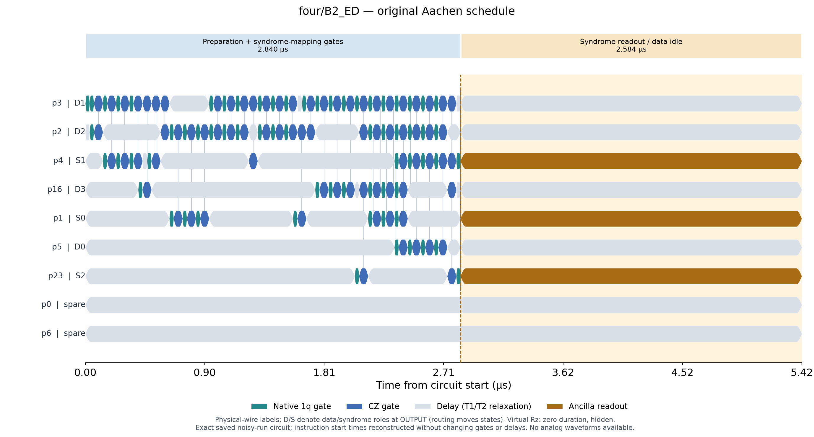
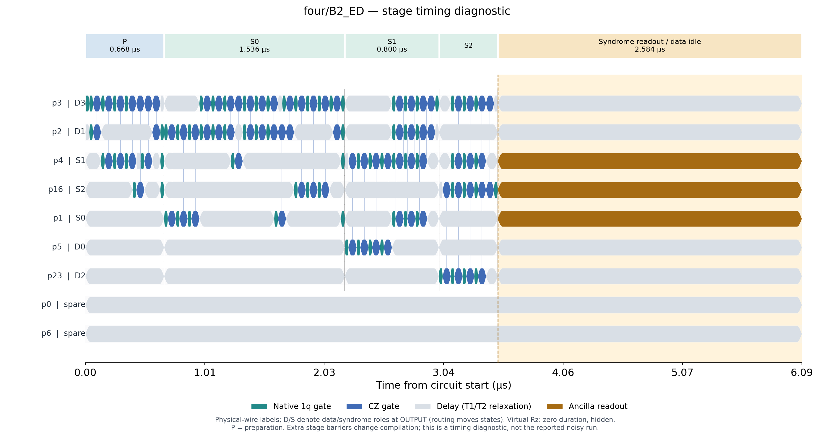
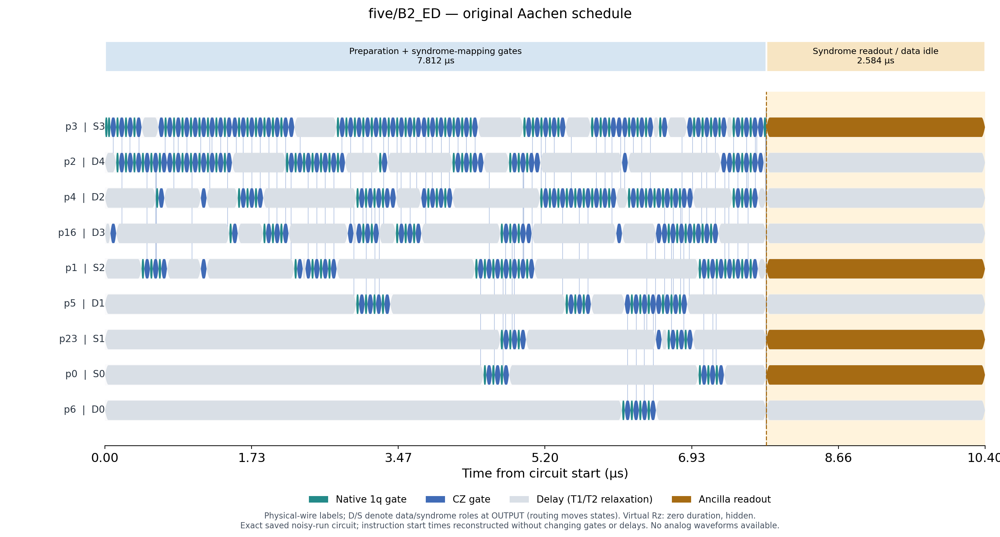
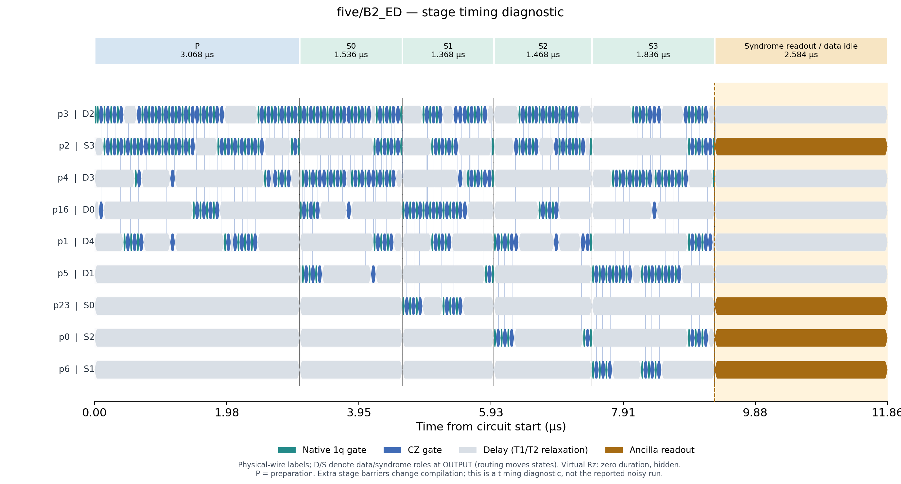
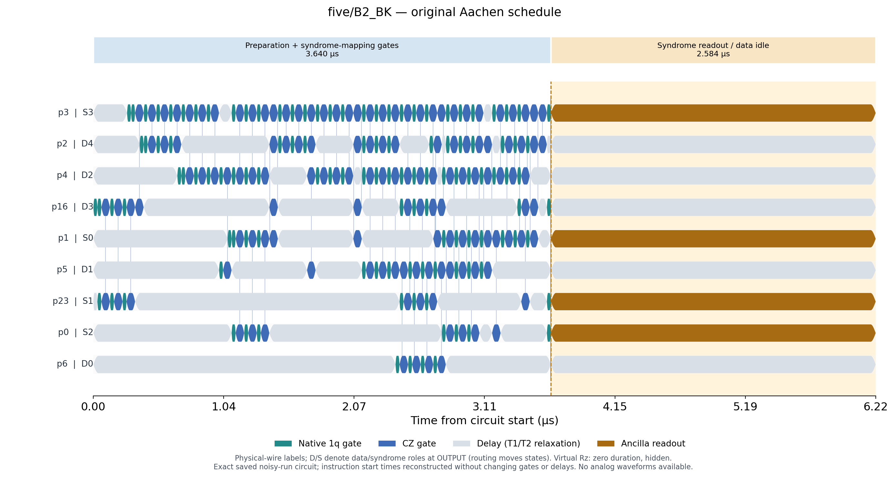
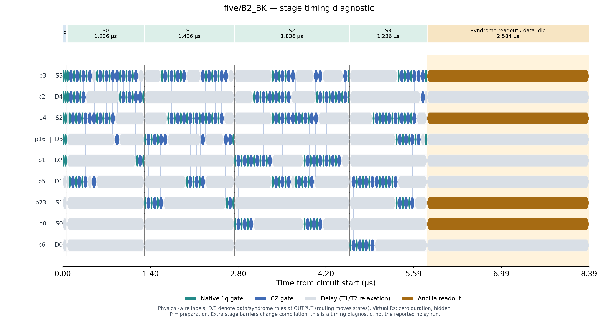

# Aachen circuit timing with Qiskit

These figures use Qiskit's `timeline_drawer` and the same calibrated instruction durations used in the noise model. They are gate/delay/readout timelines. The packaged Aachen snapshot contains no analog pulse envelopes, and Qiskit 2.4.1 does not include the removed Qiskit Pulse module. No pulse amplitudes or shapes are inferred.

## Original schedules used for the noisy results

Saved QPY circuits retain explicit delays, but not their start-time metadata. `ALAPScheduleAnalysis` reconstructs those timestamps. Instruction order, parameters, delay durations, total durations and per-wire idle totals are checked against the saved run; there is no recompilation or routing change.

| Protocol | Preparation + coherent syndrome mapping (µs) | Syndrome readout / data wait (µs) | Total (µs) |
|---|---:|---:|---:|
| four/B2_ED | 2.840 | 2.584 | 5.424 |
| five/B2_ED | 7.812 | 2.584 | 10.396 |
| five/B2_BK | 3.640 | 2.584 | 6.224 |

The first column includes input preparation and encoding where applicable; it must not be described as syndrome-extraction time alone. The optimized original circuits do not preserve source-stage boundaries. Gates can overlap or combine across those boundaries.

The orange readout bars and the simultaneous gray data-wire delays show the interval during which the existing syndrome can become stale. Every data wire waits 2.584 µs. The timelines show all physical wires in the patch; D/S labels indicate their final roles, not fixed roles throughout routing.

## Separate stage timing diagnostic

To distinguish encoding, check 0, check 1, etc., a separate compilation adds barriers between those source stages. This forbids overlap/fusion across stages and can change gate synthesis and routing. Its times describe only this diagnostic compilation and are not substituted into the original noise results. Ideal fidelity and acceptance are checked for each diagnostic circuit.

| Protocol | Preparation (µs) | Coherent syndrome mapping (µs) | Syndrome readout (µs) | Mapping + readout (µs) | Total (µs) |
|---|---:|---:|---:|---:|---:|
| four/B2_ED | 0.668 | 2.836 | 2.584 | 5.420 | 6.088 |
| five/B2_ED | 3.068 | 6.208 | 2.584 | 8.792 | 11.860 |
| five/B2_BK | 0.064 | 5.744 | 2.584 | 8.328 | 8.392 |

### four/B2_ED

| Stage | Duration (µs) |
|---|---:|
| prepare | 0.668 |
| check_0_XXXX | 1.536 |
| check_1_IIZZ | 0.800 |
| check_2_ZZII | 0.500 |

### five/B2_ED

| Stage | Duration (µs) |
|---|---:|
| prepare | 3.068 |
| check_0_XZZXI | 1.536 |
| check_1_IXZZX | 1.368 |
| check_2_XIXZZ | 1.468 |
| check_3_ZXIXZ | 1.836 |

### five/B2_BK

| Stage | Duration (µs) |
|---|---:|
| prepare | 0.064 |
| check_0_XZZXI | 1.236 |
| check_1_IXZZX | 1.436 |
| check_2_XIXZZ | 1.836 |
| check_3_ZXIXZ | 1.236 |

PNG/PDF/SVG files include full schedules and gate-region zooms. `timing_summary.json` stores every instruction's timestamp and physical wires. Barrier-separated diagnostic QPY files are saved separately; original result files are untouched.

Reproduce: `conda run -n quantum-jax python scripts/draw_timelines.py`.

References: [Qiskit timeline visualization](https://quantum.cloud.ibm.com/docs/en/api/qiskit/visualization), [Qiskit 2.0 Pulse removal](https://quantum.cloud.ibm.com/docs/en/api/qiskit/release-notes/2.0).
